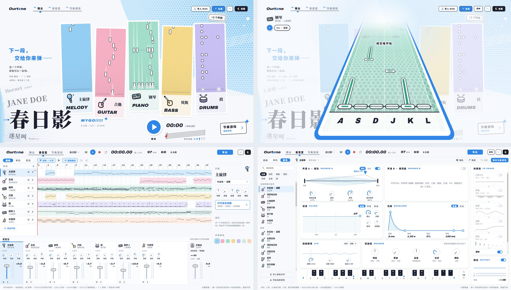
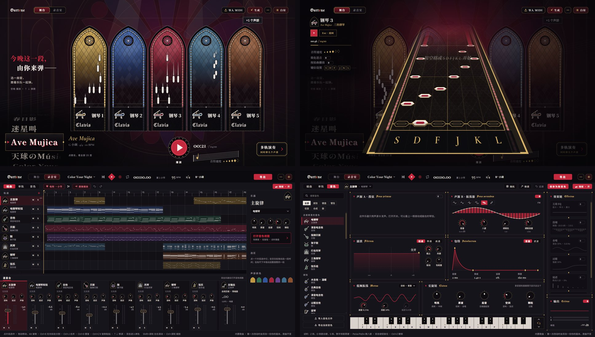

# Ourtone

简体中文 · [English](README.en.md)

一个纯前端的编曲&音游网站，支持将任意 MIDI 音轨作为谱面游玩，内置基础DAW功能。
网站支持白昼与夜幕两套主题，分别借鉴了 MyGO/Ave Mujica 风格。

- **网站（vercel海外部署）**：<https://ourtone.fun>
- **中国大陆用户**推荐使用哔哩哔哩版本，访问更稳定：<https://www.bilibili.com/toy/ourtone>



<details>
<summary>🌙 查看夜幕主题截图</summary>
<br>

</details>

## 功能

- **音游演奏**：首页点击音轨进入演奏模式，也可以同时选中多条音轨共同弹奏。音符演奏时机默认完全受玩家按键控制。支持移动设备触屏点击/滑动。
- **录音室**：编曲视图、钢琴卷帘、音色设计、混音台、麦克风录音，可以导出 MIDI、WAV 和 MP3。
- **生成器**：支持5种风格的音乐程序化自动生成（实验性功能）。
- **导入 MIDI**：支持导入 MIDI 文件进行编辑或演奏游玩。
- 内置乐器音色通过 Web Audio 实时合成，不需要采样文件，也没有服务器。数据保存在浏览器本地（IndexedDB），可以在「⋯」菜单中备份和恢复。

## 关于内置歌曲

线上网站的曲库是来自网络的同人 MIDI 改编，版权归原作者所有，因此**未包含进本仓库**。仓库只附带一首由网站自带生成器创作的示例歌曲。

## 开发方式

这个项目完全通过 vibe coding 完成：代码主要由 **Claude Opus 5.5** 编写，**GPT-6.1 Sol** 和 **GPT-6 Astra** 参与了性能优化。

## 已知性能问题

网站因需要实时合成声音，叠加画面渲染，在音游模式下负载较重。在移动设备上，尤其是 iOS，还有一些问题没有完全解决：

- iPhone 和 iPad 上演奏模式掉帧，夜幕主题下更明显。
- 手机长时间运行发热。

**非常欢迎帮忙改进性能！** 一些诊断工具：

- 网址后面加上 `?perf` 会显示性能面板（帧时间、GPU 耗时等）。
- `?playRenderer=canvas|gpu|retained` 可以切换演奏模式的渲染方式。iPhone 和 iPad 默认用 `retained`，其他设备默认用 `canvas`。
- 相关代码在 `src/rooms/stage/`：`PlayMode.svelte`（演奏模式）、`warp.ts`、`gpuCanvas.ts`、`highwayBatch.ts`（WebGL 绘制）。

如果你有修复或想法，欢迎提交 issue 或 pull request。

## 本地运行

需要 Node.js 20.19 或更新版本。

```bash
npm ci
npm run dev          # 本地开发服务器
npm run build        # 构建网站，输出到 dist/
npm run build:single # 打包成一个独立的 HTML 文件，输出到 dist-single/
npm run check        # 类型检查
```

网站是纯静态的，把 `dist/` 的内容放到任意静态托管服务上就可以运行。

离线测试（Node 环境）：

```bash
npx vite build -c vite.test.config.ts
node tests/out/chart.js   # 演奏模式的谱面检查
node tests/out/gen.js     # 生成器检查
```

### 字体

`src/assets/fonts/` 里的字体只保留了网站用到的字。修改界面文字后，请把完整字体文件（文件名见 `scripts/subset-fonts.py`，均可在 Google Fonts 下载）放进 `fonts-src/`，再运行 `npm run fonts` 重新裁剪。

## 目录结构

- `src/rooms/stage/`：舞台和演奏模式
- `src/rooms/studio/`：录音室
- `src/lib/audio/`：合成器、音色、混音和导出
- `src/lib/music/`：歌曲模型、乐理、MIDI 导入
- `src/lib/gen/`：歌曲生成器
- `src/lib/art/`：绘图、图标和标志
- `src/data/`：内置歌曲

## 许可

- 代码使用 [MIT 许可证](LICENSE)。
- `src/assets/fonts/` 中的字体使用 [SIL Open Font License 1.1](src/assets/fonts/OFL.txt)。
- 这是一个非商业的同人项目，与 MyGO!!!!!、Ave Mujica、BanG Dream!、Our Notes 及其版权方没有关联。相关名称归各自的权利人所有，不在本仓库的许可范围内。
